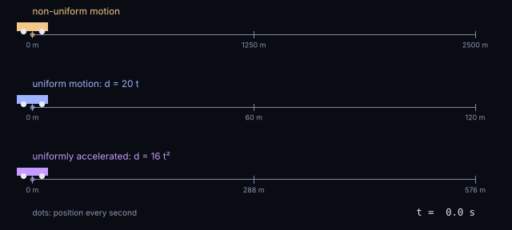

Physics studies phenomena and how they evolve over time. The simplest change we can observe in a body is a change in its position over time, which we call **motion**. Observing and recording a body's motion is fundamental to understanding its behaviour. In this chapter, we embark on a journey to describe and discuss the nature of motion.

To describe motion and related concepts, we need some fundamental mathematical tools, such as equations, before adventuring further into this book.



## Position, velocity and acceleration

I hope I do not have to convince you that describing a body's motion, or its position relative to a reference point at a given time, is crucial when studying the Universe. Just think about it: you might want to track the movement of a comet, or where a plane might crash. But it does not have to be so dramatic.

To begin with, let's consider a simple example: **Rewsna's motion on a straight road**, so that we only need to record one dimension of position. To simplify the problem, we take Rewsna's **centre of mass** as the reference.

We can characterise the motion with a simple exercise: measure Rewsna's position at different times, always recording the distance from the starting point.

| $t$ (s) | 0 | 1 | 2 | 3 | 4 | 5 | 6 | 7 | 8 | 9 | 10 |
|---|---|---|---|---|---|---|---|---|---|---|---|
| $d$ (m) | 0 | 120 | 400 | 900 | 950 | 960 | 1300 | 1800 | 2350 | 2350 | 2500 |

For better visualisation and understanding, we organise the data in a graph, which is another way to describe the movement.

```plot
{"src": "figures/motion-nonuniform.json", "caption": "Rewsna's position against time. Hover over the points to read the values.", "height": 380}
```

So what is Rewsna doing? As time increases, the distance increases: at first slowly, then more rapidly, then very slowly again for a little while between 3 and 5 s. After that the velocity increases again for a last sprint, and Rewsna stays still between 8 and 9 s. For a more complete description we would need a more detailed and longer observation. Still, we can say that the movement was not constant and that Rewsna did not reverse. So here we have a **non-uniform rectilinear motion**.

You may wonder how we can tell whether Rewsna slows down, speeds up, or even stops at some point. The answer lies in the **inclination of the plot line relative to the time axis**! A steeper line means more distance travelled in the same time: for example, Rewsna moves more slowly between 0 and 2 s than between 6 and 8 s. If the line is parallel to the time axis, Rewsna remained in the same position, or simply stopped, like between 8 and 9 s.

This motion is non-uniform because its velocity is not constant, and it is too complicated to describe with a law in the form of a simple equation.

:::note Speed or velocity?
Now let's define velocity. In everyday language we often use *speed* and *velocity* interchangeably. In physics, we take advantage of the two terms to tell apart two related concepts: **velocity** has both magnitude and direction, while **speed** is only the magnitude of the velocity, without its direction. The example was chosen so that we only need to focus on the magnitude.
:::

## Uniform motion

Now imagine our little friend sliding in a place where it moves without friction. It moves smoothly and, just like before, we record its motion.

| $t$ (s) | 0 | 1 | 2 | 3 | 4 | 5 | 6 |
|---|---|---|---|---|---|---|---|
| $d$ (m) | 0 | 20 | 40 | 60 | 80 | 100 | 120 |

```plot
{"src": "figures/motion-uniform.json", "caption": "Rewsna sliding without friction: the points fall on a straight line, d(t) = 20 t.", "height": 360}
```

The data build a **linear pattern**, with a single inclination and a constant velocity. This example clearly shows **uniform rectilinear motion**.

If you look at the table, you'll notice that the positions follow a clear trend and are proportional to time. This is because the law of motion can be written as

$$d(t) = 20\,t.$$

By now it's clear that the inclination of the line relative to the time axis is directly related to the velocity. With any two points of the plot we can compute the velocity and relate it to an equation of motion:

$$v = \frac{\Delta d}{\Delta t} = \frac{d_f - d_i}{t_f - t_i} = \frac{40 - 20}{2 - 1} = \frac{120 - 60}{6 - 3} = 20\ \text{m/s}.$$

Starting the clock at $t_0 = 0$ from the origin, we get a more general expression for the velocity:

$$v = \frac{d}{t}.$$

What about acceleration and direction? Does this apply to all cases?

## Uniformly accelerated motion

Suppose we add a **motor** to the toy. Now it has an accelerated motion, more specifically a **uniformly accelerated motion**. There it goes…

| $t$ (s) | 0 | 1 | 2 | 3 | 4 | 5 | 6 |
|---|---|---|---|---|---|---|---|
| $d$ (m) | 0 | 16 | 64 | 144 | 256 | 400 | 576 |

Compared with the previous example, Rewsna travels much farther in the same time. The points now follow a curve,

$$d(t) = 16\,t^2.$$

But how can we know the velocity at each moment? With the previous formula we only get an **average** velocity:

$$v_m = \frac{\Delta d}{\Delta t} = \frac{576 - 0}{6 - 0} = 96\ \text{m/s}.$$

The inclination of the curve keeps increasing, so the velocity is constantly changing. To get closer to the **instantaneous** velocity, we take a smaller and smaller time interval and the distance travelled in it, and form their ratio. In other words, we take the **limit** of the distance travelled divided by the time taken, as the time gets smaller and smaller, ad infinitum:

$$v = \lim_{\Delta t \to 0} \frac{\Delta d}{\Delta t} = \frac{\mathrm{d}}{\mathrm{d}t}\,d(t).$$

This idea was invented by Newton and by Leibniz, independently, and it is the beginning of a new branch of mathematics: **differential calculus**. The quantity above is called the *derivative of $d$ with respect to $t$*, and finding it is called *differentiating*. The small $\mathrm{d}$'s that appear on their own are called *differentials*.

Geometrically, this limit is the slope of the **tangent line** to the curve at that point. Drawing the tangents shows how the velocity grows:

```plot
{"src": "figures/motion-accelerated.json", "caption": "Rewsna with a motor: d(t) = 16 t². The green dashed lines are tangents at t = 1 to 5 s; their slope is the velocity at that instant.", "height": 400}
```

If we record the slope of each tangent and plot it, the velocity turns out to be a **straight line**. That is why this motion is called *uniformly* accelerated.

| $t$ (s) | 0 | 1 | 2 | 3 | 4 | 5 | 6 |
|---|---|---|---|---|---|---|---|
| $v$ (m/s) | 0 | 32 | 64 | 96 | 128 | 160 | 192 |

```plot
{"src": "figures/motion-velocity.json", "caption": "Rewsna's velocity with the motor: v(t) = 32 t.", "height": 360}
```

The velocity is described by $v(t) = 32\,t$, and its slope is the **acceleration**. Using any two points:

$$a = \frac{\Delta v}{\Delta t} = \frac{v_f - v_i}{t_f - t_i} = \frac{160 - 64}{5 - 2} = 32\ \text{m/s}^2.$$

## From velocity back to distance

We can also go the other way. If we split the time into small intervals $\Delta t$, the distance travelled is roughly the sum of the velocity in each interval times its duration:

$$d \approx \sum_i v(t_i)\,\Delta t,$$

where the Greek letter $\Sigma$ (sigma) means "add up", and $t_{i+1} = t_i + \Delta t$. This is not exact, because the velocity changes during each interval. But the shorter the intervals, the closer we get to the true distance. Move the slider below to shrink $\Delta t$ and watch the sum approach the true distance, 576 m:

```plot
{"src": "figures/motion-riemann.json", "caption": "Distance as a sum of rectangles v(tᵢ) Δt under the velocity line. As Δt shrinks, the total approaches the area under the line: 576 m.", "height": 420}
```

In the limit of infinitely small intervals,

$$d = \lim_{\Delta t \to 0} \sum_i v(t_i)\,\Delta t = \int v(t)\,\mathrm{d}t.$$

Mathematicians invented a symbol for this limit, just like for the differential: the $\Delta$ becomes a $\mathrm{d}$, and the sum is written $\int$, a stretched "S" for the Latin *summa*, now simply called the **integral** sign. Adding up all these tiny pieces is called **integration**, and it is the opposite of differentiation: you can find integrals by running the rules for derivatives backwards.

With these tools, the velocity is the time derivative of the position:

$$v = \frac{\mathrm{d}}{\mathrm{d}t}\left(16\,t^2\right) = 16 \cdot 2\,t^{2-1} = 32\,t,$$

and, with the same logic, the acceleration is the time derivative of the velocity:

$$a = \frac{\mathrm{d}}{\mathrm{d}t}\left(\frac{\mathrm{d}}{\mathrm{d}t}\,d(t)\right) = \frac{\mathrm{d}}{\mathrm{d}t}\,v(t) = \frac{\mathrm{d}}{\mathrm{d}t}(32\,t) = 32\ \text{m/s}^2.$$

Another example of this kind of motion is a **falling object**, which has a constant acceleration due to gravity. For Rewsna, it was the motor that pushed it. Both show how **forces change velocity**, the theme of the next chapter.

## The equations of constant acceleration

With the motor, Rewsna started from rest at the origin. In general an object can start at position $x_0$ with velocity $v_0$. Integrating a constant acceleration twice gives three equations you will use again and again:

$$v = v_0 + a t$$

$$x = x_0 + v_0 t + \tfrac{1}{2} a t^2$$

$$v^2 = v_0^2 + 2a\,(x - x_0)$$

Here is a ball thrown straight up at $v_0 = 12\ \text{m/s}$ with $a = -9.81\ \text{m/s}^2$. The position is a parabola; the velocity is a straight line that crosses zero exactly when the ball is at its highest point.

 and velocity (right).")

## Measuring g yourself

Drop an object, record how far it has fallen at several times, and fit $d = \tfrac{1}{2} g t^2$. The plot below is interactive: hover over the points, zoom in, and read the fitted value of $g$ from the legend.

```plot
{"src": "figures/free-fall-fit.json", "caption": "Simulated free-fall measurements with a quadratic fit.", "height": 400}
```

## Exercises

:::exercise Reading Rewsna's journey
Using the table of Rewsna's non-uniform motion, find its average velocity between 0 and 2 s, between 6 and 8 s, and over the whole 10 s.
:::solution
Between 0 and 2 s: $v_m = \dfrac{400 - 0}{2} = 200\ \text{m/s}$.

Between 6 and 8 s: $v_m = \dfrac{2350 - 1300}{2} = 525\ \text{m/s}$, much faster, as the steeper line shows.

Over 10 s: $v_m = \dfrac{2500}{10} = 250\ \text{m/s}$.
:::
:::

:::exercise Rewsna with a motor
For Rewsna with $d(t) = 16\,t^2$, find the average velocity between 2 and 4 s, and the instantaneous velocity at 3 s. Why are they equal?
:::solution
Average: $v_m = \dfrac{256 - 64}{4 - 2} = 96\ \text{m/s}$.

Instantaneous: $v(3) = 32 \times 3 = 96\ \text{m/s}$.

They are equal because the velocity grows linearly with time, so the average over an interval is the velocity at its midpoint. This is true for any uniformly accelerated motion.
:::
:::

:::exercise A car from rest
A car starts from rest and accelerates at $3\ \text{m/s}^2$ for $5\ \text{s}$. How fast is it going, and how far has it travelled?
:::solution
$v = v_0 + at = 0 + 3 \times 5 = 15\ \text{m/s}$.

$x = \tfrac{1}{2} a t^2 = \tfrac{1}{2} \times 3 \times 25 = 37.5\ \text{m}$.
:::
:::

:::exercise Up and down
A ball is thrown straight up at $12\ \text{m/s}$. How high does it go, and how long until it comes back to your hand?
:::solution
At the top $v = 0$, so $0 = v_0^2 - 2 g h$ gives $h = \dfrac{v_0^2}{2g} = \dfrac{144}{19.62} \approx 7.3\ \text{m}$.

The time to the top is $t = v_0 / g \approx 1.22\ \text{s}$, and the way down takes just as long, so it returns after about $2.45\ \text{s}$. Compare with the plot above.
:::
:::

:::exercise Braking distance
A car travelling at $25\ \text{m/s}$ (90 km/h) brakes and stops in $50\ \text{m}$. What is its deceleration, and how long does it take to stop?
:::solution
From $v^2 = v_0^2 + 2a\,\Delta x$ with $v = 0$: $a = -\dfrac{v_0^2}{2\Delta x} = -\dfrac{625}{100} = -6.25\ \text{m/s}^2$.

Then $t = \dfrac{v - v_0}{a} = \dfrac{-25}{-6.25} = 4\ \text{s}$.
:::
:::
