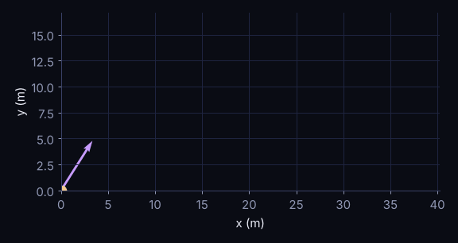

A thrown ball traces a curve, but its motion is two simple motions happening at once. **Horizontally nothing pushes it**, so it moves at constant speed. **Vertically gravity pulls it**, so it accelerates downward exactly as in the previous chapter.



## Splitting the motion

Launch at speed $v_0$ and angle $\theta$ above the horizontal. The two components of the initial velocity are $v_0\cos\theta$ and $v_0\sin\theta$, so

$$x(t) = v_0 \cos\theta \; t, \qquad y(t) = v_0 \sin\theta \; t - \tfrac{1}{2} g t^2 .$$

Eliminating $t$ gives the shape of the path, a parabola:

$$y = x\tan\theta - \frac{g\,x^2}{2 v_0^2 \cos^2\theta}.$$

## Range, height and time of flight

Setting $y = 0$ and solving gives the three numbers everybody asks for:

$$T = \frac{2 v_0 \sin\theta}{g}, \qquad R = \frac{v_0^2 \sin 2\theta}{g}, \qquad H = \frac{v_0^2 \sin^2\theta}{2g}.$$

The plot compares three launch angles at $v_0 = 20\ \text{m/s}$. Notice that 30° and 60° land in the same place.

```plot
{"fn": [
  {"y": "x*tan(PI/6) - 9.81*x*x/(2*400*cos(PI/6)**2)", "name": "30°"},
  {"y": "x*tan(PI/4) - 9.81*x*x/(2*400*cos(PI/4)**2)", "name": "45°"},
  {"y": "x*tan(PI/3) - 9.81*x*x/(2*400*cos(PI/3)**2)", "name": "60°"}
 ],
 "x": [0, 41],
 "layout": {"xaxis": {"title": {"text": "x (m)"}}, "yaxis": {"title": {"text": "y (m)"}, "range": [0, 16]}},
 "caption": "Trajectories at 20 m/s for three launch angles (no air resistance).",
 "height": 360}
```

## Exercises

:::exercise The best angle
Using $R = v_0^2 \sin 2\theta / g$, which angle gives the longest range? What is that range for $v_0 = 20\ \text{m/s}$?
:::solution
$\sin 2\theta$ is largest (equal to 1) when $2\theta = 90°$, so $\theta = 45°$.

$R_\text{max} = v_0^2 / g = 400 / 9.81 \approx 40.8\ \text{m}$.
:::
:::

:::exercise Complementary angles
Show that launch angles $\theta$ and $90° - \theta$ give the same range.
:::solution
$\sin 2(90° - \theta) = \sin(180° - 2\theta) = \sin 2\theta$, so $R$ is the same. The steeper launch goes higher and stays in the air longer, but covers the same ground.
:::
:::

:::warning The real world
Air resistance shortens every trajectory and makes the best angle a little smaller than 45°. We'll add it in a later chapter.
:::
