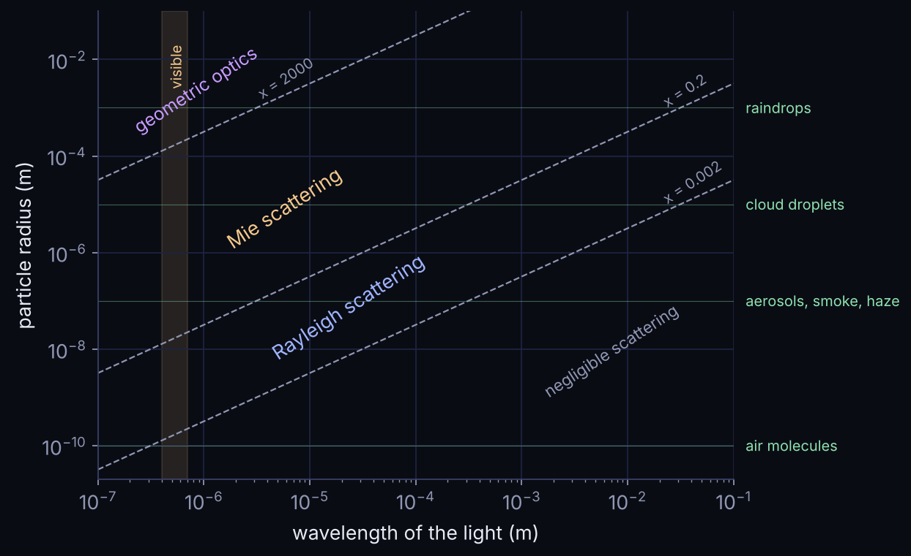

Rayleigh scattering works for air molecules, but the atmosphere also holds **aerosols**: dust, sea salt, sulphates, water droplets and ice crystals. These are comparable in size to the wavelength of light, or larger ($x = 2\pi r/\lambda \gtrsim 1$), and Rayleigh's approximation breaks down. The exact solution for a sphere of any size was found independently by Ludvig Lorenz (1890) and Gustav Mie (1908).

## What changes with size

**Colour.** For small particles, scattering grows as $\lambda^{-4}$. For larger particles, it depends much less on wavelength. This is why clouds, made of droplets much bigger than the wavelength, are white, and why a dusty or hazy sky looks paler.

**Direction.** Large particles scatter most of the light **forwards**, in a narrow lobe around the direction of the incoming beam. In the night sky, this makes the sky much brighter close to the Moon. A common approximation for this shape is the Henyey–Greenstein phase function,

$$P(\gamma) = \frac{1-q^2}{(1+q^2-2q\cos\gamma)^{3/2}},$$

where $q$ goes from 0 (equal forwards and backwards) to 1 (all forwards).

**Polarisation.** Larger particles polarise light much less, and the polarisation pattern no longer peaks at $90°$: it can oscillate and even change sign.

## The Mie solution

Mie theory expands the scattered wave in an infinite series. The two **scattering amplitudes**, for light polarised perpendicular and parallel to the scattering plane, are

$$S_1(\gamma) = \sum_{n=1}^{\infty}\frac{2n+1}{n(n+1)}\left[a_n\pi_n(\cos\gamma) + b_n\tau_n(\cos\gamma)\right],$$
$$S_2(\gamma) = \sum_{n=1}^{\infty}\frac{2n+1}{n(n+1)}\left[b_n\pi_n(\cos\gamma) + a_n\tau_n(\cos\gamma)\right].$$

The angular functions $\pi_n$ and $\tau_n$ come from Legendre polynomials, and the coefficients $a_n$, $b_n$ depend on the size parameter $x$ and the refractive index $m$ of the particle (through Riccati–Bessel functions).

From them, the scattered intensities are $i_1 = |S_1|^2$ and $i_2 = |S_2|^2$, and the degree of polarisation of unpolarised light is

$$p = \frac{i_1 - i_2}{i_1 + i_2}.$$

How efficiently a particle scatters and absorbs light also follows from the same coefficients:

$$Q_s = \frac{2}{x^2}\sum_{n=1}^{\infty}(2n+1)\left(|a_n|^2+|b_n|^2\right), \qquad Q_e = \frac{2}{x^2}\sum_{n=1}^{\infty}(2n+1)\,\text{Re}(a_n+b_n), \qquad Q_a = Q_e - Q_s.$$

For spheres, the [Mueller](read.html?c=research&s=mueller-formalism) scattering matrix has only four independent elements, all built from $S_1$ and $S_2$.

## In the real atmosphere

Aerosols come in many types and sizes. Models of the sky above Paranal (Jones et al. 2013, 2019) describe them as several species (nucleation, accumulation, coarse and stratospheric particles, and dust), each with a log-normal size distribution. Adding up their Mie scattering gives the aerosol contribution to the sky.

In [our study of the moonlit sky](read.html?c=research&s=moonlit-sky-paranal), Mie scattering was essential to reproduce how quickly the sky brightens towards the Moon, something Rayleigh scattering alone cannot do.

:::note From my thesis
This page is based on Chapter 2 of my master's thesis, *Polarization patterns in the sky and their influence on astronomical observations* (Instituto Superior Técnico, 2022), which goes into more detail.
:::

## References

1. B. Pereira (2022). *Polarization patterns in the sky and their influence on astronomical observations*. Master's thesis, Instituto Superior Técnico, Lisbon.
2. K.-N. Liou (2002). *An Introduction to Atmospheric Radiation*. Academic Press (Elsevier).
3. S. G. Narasimhan & S. K. Nayar (2003). Shedding light on the weather. *IEEE CVPR 2003*.
4. A. Jones, S. Noll, W. Kausch, C. Szyszka & S. Kimeswenger (2013). An advanced scattered moonlight model for Cerro Paranal. *A&A* 560, A91.
5. A. Jones et al. (2019). *A&A* 624, A39.
6. B. Pereira, S. González-Gaitán, A. M. Mourão et al. (2026). Moonlit sky polarization patterns from Cerro Paranal. *A&A*. [doi:10.1051/0004-6361/202555617](https://doi.org/10.1051/0004-6361/202555617).
