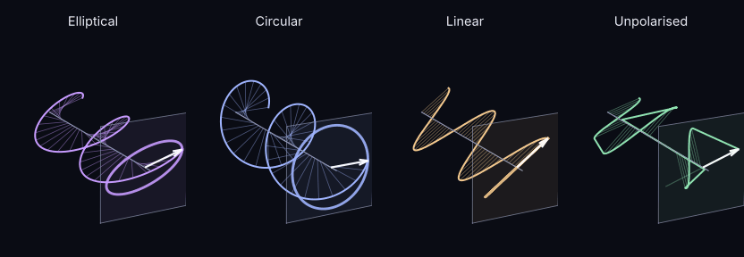

Light is an electromagnetic wave: an electric field $\vec E$ and a magnetic field $\vec B$ that oscillate perpendicular to each other and to the direction the wave travels. Maxwell's equations tie the two together, so knowing $\vec E$ is enough to know everything. **Polarisation describes how the electric field oscillates.**

 and magnetic field (blue) oscillate at right angles to each other and to the direction of travel.")

## The electric field of a wave

Take a wave travelling along $z$. The electric field lives in the $xy$ plane, and we can split it into two components:

$$E_x(t) = E_x(0)\cos(\omega t - \phi_1), \qquad E_y(t) = E_y(0)\cos(\omega t - \phi_2).$$

Everything about the polarisation is in four numbers: the two amplitudes $E_x(0)$, $E_y(0)$ and the two phases $\phi_1$, $\phi_2$. Really only the **phase difference** $\beta = \phi_2 - \phi_1$ matters.

## Three kinds of polarisation

**Linear.** If the two components are in phase ($\beta = 0$), the field always points in the same direction; only its length changes. The tip of $\vec E$ moves back and forth along a line, at an angle $\psi$ (the *polarisation angle*) set by the ratio $E_y(0)/E_x(0)$.

**Circular.** If the amplitudes are equal and the phases differ by a quarter of a cycle ($\beta = \pm\pi/2$),

$$E_x = E_0\cos\omega t, \qquad E_y = \mp E_0\sin\omega t,$$

and the tip of $\vec E$ draws a circle. Turning anticlockwise (seen facing the source) is called right-handed, clockwise left-handed.

**Elliptical.** Any other combination of amplitudes and phase difference makes the tip trace an ellipse. This is the most general case: linear and circular polarisation are just squashed and perfectly round ellipses.

## Natural light

A single wave is always perfectly polarised in one of these ways. But the light from a star, the Sun or a lamp is the sum of countless waves emitted independently by atoms, with all orientations equally likely. On average they cancel, and the light is **unpolarised**, also called *natural light*.

Light becomes polarised when something breaks that symmetry: reflection, scattering, or passing through a polariser. That is exactly what happens when sunlight or moonlight is scattered by the atmosphere.

To describe partly polarised light from real sources we need new tools: the [Jones calculus](read.html?c=research&s=jones-calculus) for perfectly polarised waves, and the [Stokes parameters](read.html?c=research&s=stokes-parameters) for everything else.

:::note From my thesis
This page is based on Chapter 1 of my master's thesis, *Polarization patterns in the sky and their influence on astronomical observations* (Instituto Superior Técnico, 2022), which goes into more detail.
:::

## References

1. B. Pereira (2022). *Polarization patterns in the sky and their influence on astronomical observations*. Master's thesis, Instituto Superior Técnico, Lisbon.
2. J. D. Jackson (1999). *Classical Electrodynamics*, 3rd ed. Wiley.
3. S. Trippe (2014). Polarization and polarimetry: a review. [arXiv:1401.1911](https://arxiv.org/abs/1401.1911).
